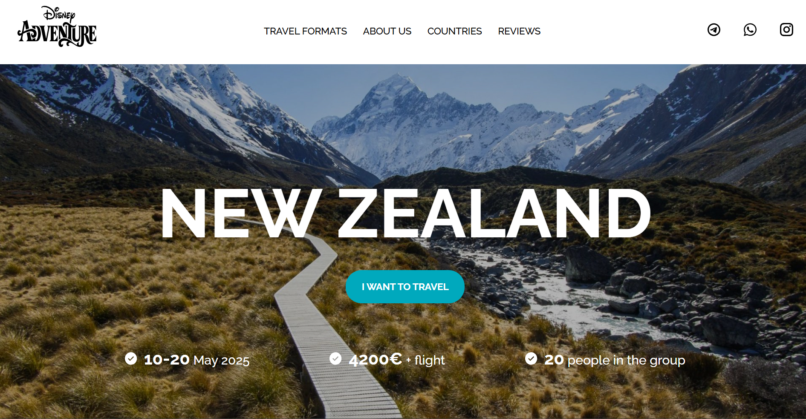

# Disney Adventure

Learning project: a landing page for a travel agency with group tours. The featured tour is New Zealand, with a program by day, an impressions slider and a list of other tours.

**Live demo:** https://drozdtatsiana.github.io/disney-adventure/



## Features

- Responsive layout (desktop, tablet, mobile) with a burger menu
- Tour program with automatic day numbers (CSS counters)
- Photo slider with a fade effect, arrows and pagination ([Swiper](https://swiperjs.com/))
- "Our other tours" cards: the active card expands on click or with the keyboard (Enter / Space)
- Grid-based gallery section
- Semantic markup, alt texts, `aria-label`s and visible keyboard focus

## Tech stack

- HTML5
- CSS3 (Flexbox, Grid, custom fonts, media queries, counters)
- JavaScript (ES6)
- Swiper 12

## Project structure

```
disney/
├── index.html
├── css/
│   ├── reset.css
│   └── style.css
├── js/
│   └── main.js
├── fonts/
└── images/
```

## Run locally

1. Clone the repository:
   ```bash
   git clone https://github.com/drozdtatsiana/disney-adventure.git
   ```
2. Open the folder in VS Code and start `index.html` with the Live Server extension (or just open it in a browser).

## Author

Tatsiana Drozd, [@drozdtatsiana](https://github.com/drozdtatsiana)
